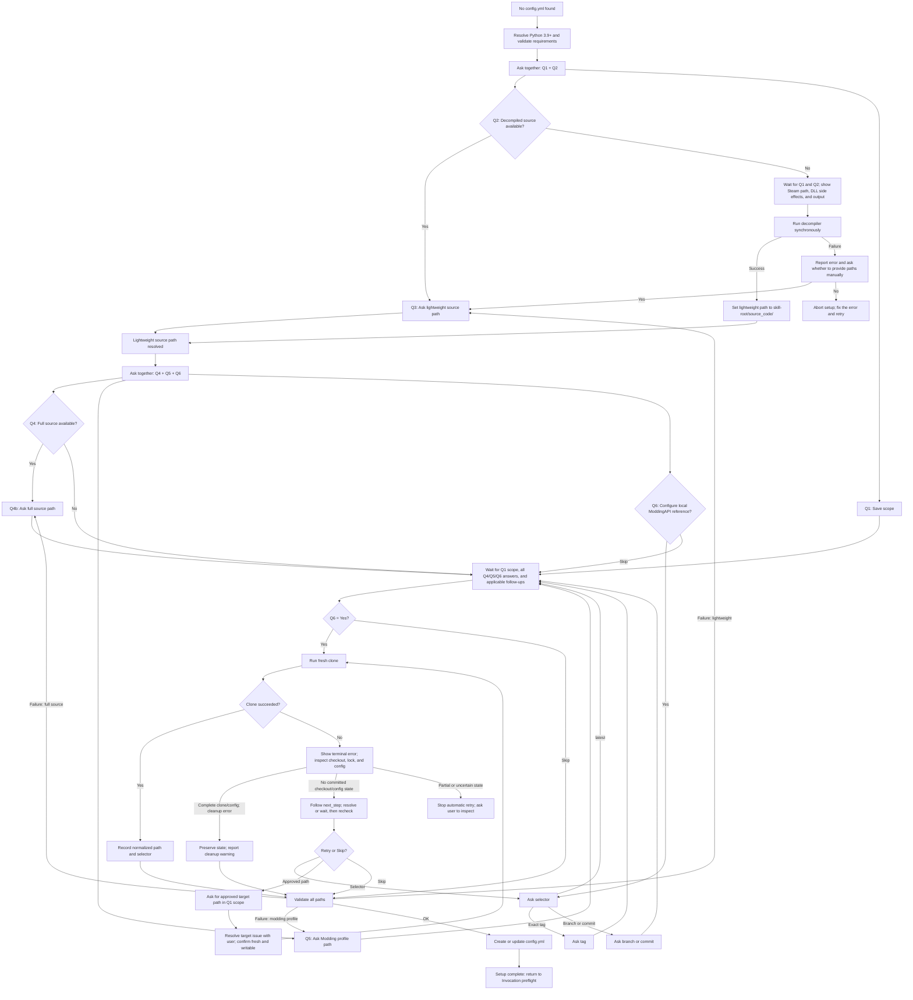

# First-Time Setup

## Overview

When no `config.yml` is found, this reference describes configuration setup flow.

Shared [Invocation preflight](invocation-preflight.md) reference owns blocking gate, configuration precedence, tracked-session stop exception, path recovery, and completion contract. This reference owns detailed setup questions, validation, and save operations after that gate selects missing-configuration state.

Before executing command in this reference, agent MUST apply command-context contract in [Invocation preflight](invocation-preflight.md).

Agent MUST ask only questions in this setup flow, MUST save `config.yml`, and MUST continue only after those steps complete.

Before asking Q1, agent MUST complete the [Python runtime gate](python-runtime.md). Q1 remains the first user question. A failed runtime gate MUST stop setup, show its stable configuration diagnostic, and provide the retry action; it MUST NOT install packages or write `config.yml`.

On success, agent MUST return the validated configuration file to Invocation preflight completion check. On failure, agent MUST report error and retry path through that same contract.

## Setup Flow



## Question Batches

After the Python runtime gate succeeds, agent MUST present setup questions as ordinary numbered text in the user's input language when available. Agent MUST NOT use agent or harness question components. Each question MUST include its existing identifier. Choice questions MUST show applicable choices and a recommendation; path questions MUST request an existing path without suggesting a default. For environment-dependent choices, the recommendation MUST match the user's actual state. Agent MUST treat recommendations as guidance, not answers.

The first message MUST ask Q1 and Q2 together, in that order. If Q2 is answered **Yes**, agent MUST ask Q3 for the lightweight path. If Q2 is answered **No**, agent MUST wait until Q1 and Q2 are both answered before following the decompiler disclosure and safety gates below. Successful decompilation MUST auto-fill Q3; after failure, agent MUST ask whether to provide paths manually and MUST ask Q3 only if the user chooses manual paths. Once the lightweight source path is provided or auto-filled, agent MUST ask Q4, Q5, and Q6 together. Agent MUST ask Q4b only after Q4 is answered **Yes**, the selector only after Q6 is answered **Yes**, and tag, branch, or commit details only after the selector choice requires them. Questions MAY share a message once all their prerequisites are settled.

Agent MUST mark only explicitly provided answers as settled. At the next frontier, agent MUST ask every unanswered question whose applicability and wording are known, including newly eligible questions alongside unanswered questions from the prior batch. Agent MUST NOT ask settled questions again. Agent MUST defer a question only when an unresolved answer determines whether it applies or how it should be asked. A later operation needing an answer MUST NOT by itself split otherwise independent questions into separate batches.

Agent MUST wait for each operation's required answers and checks before running it. The decompiler MUST NOT run until Q1 and Q2 are both explicitly answered; agent MUST present the existing execution disclosure and satisfy the safety checks below. Before cloning, agent MUST wait for Q1 scope, all answers in the Q4/Q5/Q6 batch, and any applicable Q4b or selector details; it MUST then pass the existing writable-parent and fresh-target checks. Agent MUST validate and save only after all applicable answers and required operations are complete. Agent MUST preserve the existing retry and setup-completion requirements.

### Q1: Save Location

**Question:** Where do you want to save the configuration?

- **User (Recommended):** User scope; see the config schema at [approved local reference locations](preferences-schema.md#approved-local-reference-locations); available across projects.
- **Project:** Project scope; see the same config schema; scoped to this repository.

Q1 MUST remain first within the initial Q1/Q2 message so its answer is available for the decompiler's destination disclosure.

### Q2: Decompiled Source Branch

**Question:** Do you have decompiled Blasphemous source code?

- **Yes (Recommended when decompiled source is already available):** The user will provide an existing source path.
- **No (run decompiler; Recommended when source is unavailable):** The decompiler obtains source for this branch.

When the user selects **No**, that choice authorizes source acquisition. Before running the script, agent MUST show the resolved Steam game installation path, the `Assembly-CSharp.dll` and `Assembly-CSharp-firstpass.dll` files that will be removed, the Steam restoration step, the output path, and the required Steam, .NET, and `ilspycmd` tools.

- The Steam game installation MUST be resolved separately from `modding_profile_path`; the decompile branch MUST NOT substitute the Modding profile as its source-acquisition path.
- Agent MUST validate the selected game path before the destructive step and stop when the path or required tools are invalid.
- Agent MUST then run the decompile script synchronously:
  - **Windows**: `& $PYTHON3 (Join-Path $SkillRoot 'scripts\decompile_source.py')`
  - **macOS/Linux**: `"$PYTHON3" "$SKILL_ROOT/scripts/decompile_source.py"`
- On success, agent MUST auto-fill `lightweight_source_code_path` to `<skill-root>/source_code/`. On failure, agent MUST ask whether to provide paths manually or abort setup.

When the user selects **Yes**, agent MUST enter manual path flow.

### Q3: Lightweight Source Code Path

**Question:** Where is your lightweight source code of decompiled Blasphemous project's core files?

**Input guidance:** Agent MUST request an existing path and MUST NOT invent a default.

- This is the **minimum required field**. At least lightweight MUST be set.
- For the decompile branch (Q2 = **No**), this path is auto-determined; agent MUST skip this question.

### Q4: Full Source Code (optional)

**Question:** Do you also have full decompiled Blasphemous source code (.sln with all projects)?

- **Yes (Recommended when a full source tree is available):** The full source path is requested next.
- **No (Recommended when a full source tree is unavailable):** Full source is skipped; setup continues with lightweight source only.

### Q4b: Full Source Code Path (conditional)

**Question:** Where is your full source code of the decompiled Blasphemous project?

**Input guidance:** Agent MUST request an existing path and MUST NOT invent a default.

Agent MUST ask this only if the user answered **Yes** to Q4.

### Q5: Modding Profile Path

**Question:** Where is your Blasphemous modding profile root path?

**Input guidance:** Agent MUST request an existing path and MUST NOT invent a default.

This path MUST be entered manually in all branches. A Modding profile is typically a full game copy, not part of the original game installation, so it cannot be auto-detected from the game path.

### Q6: Local ModdingAPI Reference

**Question:** Configure a local ModdingAPI reference checkout?

- **Yes (Recommended):** A shallow, reproducible checkout is cloned and its absolute path and selector are saved in `config.yml`.
- **Skip:** Local reference fields remain absent and the release-aware remote fallback is used.

If the user selects **Yes**, agent MUST use the same scope selected in Q1. Agent MUST NOT select an independent reference scope: local reference and its configuration MUST remain in the same scope domain. Approved paths are authoritative in [the config schema](preferences-schema.md#approved-local-reference-locations).

### Reference Selector

Agent MUST ask this only after Q6 is answered **Yes**:

**Question:** Which ModdingAPI reference do you want to clone?

- **latest (Recommended):** Newest non-draft, non-prerelease GitHub Release.
- **Exact tag:** A named Release tag is selected with `tag:REF`.
- **Explicit branch or commit:** A branch or commit is selected with `branch:REF` or `commit:SHA` for deliberate development or source pinning.

For **Exact tag**, agent MUST request the tag name and pass `tag:REF`. For an explicit branch or commit, agent MUST request the branch name or 40-character SHA and pass `branch:REF` or `commit:SHA`. `latest` needs no additional value. Agent MUST ask only for details required by the selected option and MUST NOT suggest a fabricated ref.

Agent MUST run the matching fresh-clone command from the caller's Mod repository using the explicit Skill-root path:

```bash
"$PYTHON3" "$SKILL_ROOT/scripts/clone_modding_api.py" --scope user --selector latest
```

```powershell
& $PYTHON3 (Join-Path $SkillRoot 'scripts\clone_modding_api.py') -Scope user -Selector latest
```

Agent MUST use `--scope project` / `-Scope project` when Q1 selected Project and MUST use User when Q1 selected User. The clone command refuses an existing target, uses shallow history by default, checks out tags and commits detached, creates a tracking branch for explicit branches, writes the normalized absolute path plus selector to the selected `config.yml`, and writes the sibling lock state described in [the config schema](preferences-schema.md#sibling-lock-state). It does not replace an existing checkout.

For a retry that changes the checkout path, agent MUST request the approved local reference path for Q1 from the config schema and MUST NOT use an alternate location. Agent MUST pass it with `--target-path PATH` (`-TargetPath PATH` in PowerShell); `--scope` MUST still match Q1 so the same configuration scope is used. Agent MUST disclose that the command may create missing parent directories but will not replace an existing target or sibling lock, and MUST rerun the existing fresh-target and writable-parent checks. If no valid approved target is available, agent MUST offer Skip or ask the user to resolve the approved target; it MUST NOT bypass the scope rule.

## Validate User Input

Agent MUST validate whether user-input paths exist and are valid using command-line tools.

Validation criteria:
- All branches:
  - `lightweight_source_code_path` **MUST** exist — validate that root path exists; it SHOULD ideally contain `.sln` file
  - `full_source_code_path` (if provided) — validate that root path exists; it SHOULD ideally contain `.sln` file
  - `modding_profile_path` (if provided) — it SHOULD contain `Blasphemous.exe` and `Modding` folder
  - When Q6 is enabled, local ModdingAPI reference parent MUST be writable, and fresh-clone target MUST NOT already exist.
- If any check fails, agent MUST return to **corresponding single question** (not entire flow):
  - Lightweight fail → retry Q3 only
  - Full fail (if provided) → retry Q4b only
  - Modding profile fail → retry Q5 only
- Agent MUST retain every unrelated valid answer and successful branch result
  when retrying. A failed path check MUST re-ask only its corresponding question;
  it MUST NOT discard Q1, Q2, other valid paths, or a successful decompile.
- Decompile branch: script exit code 0 validates lightweight automatically

**Script failure handling** (Q2 = No, script exit code != 0):

1. Agent MUST display the script's error output to the user.
2. Agent MUST ask in ordinary text and in the user's input language whether they want to provide source paths manually or abort setup.
   - **Yes:** Agent SHOULD recommend this when the user can provide an existing source path; agent MUST continue at Q3.
   - **No:** Agent MUST abort setup and instruct the user to resolve the error and retry.

**Local reference failure handling** (Q6 = Yes, clone exit code != 0):

1. Agent MUST display the clone command's terminal error report.
2. Agent MUST inspect the checkout, sibling lock, and selected `config.yml` before treating the operation as failed. If the report says `clone completed but cleanup failed` and the checkout, lock, and config agree on the selected path and selector, agent MUST preserve that state, continue setup validation, and report the cleanup warning; it MUST NOT retry or remove artifacts automatically.
3. If rollback failed or the checkout, lock, or config state is incomplete or uncertain, agent MUST stop automatic retry and Skip handling and ask the user to inspect or reconcile the state. Agent MUST NOT manually write, overwrite, or remove reference fields or checkout data.
4. If no checkout or config state was committed, including a failure before the clone transaction begins or a clean rollback, agent MUST follow the report's `next_step` and recheck state before offering retry or Skip. If another clone may still be running, agent MUST wait for it to finish before checking state; it MUST ask the user to resolve a confirmed stale clone lock and MUST NOT remove it automatically. Only after the issue is resolved and no state is committed, agent MUST ask in ordinary text and in the user's input language whether to retry with a corrected selector, an approved target path, or Skip. Agent MUST request only the correction needed for the retry; for a target path, it MUST follow the path requirements above. Agent SHOULD recommend Retry when the error is correctable; Skip leaves the release-aware remote fallback enabled because no local reference state was committed.
5. Agent MUST retain Q1-Q5 and all validated paths while retrying or skipping the optional clone.

## Save Locations

Agent MUST use approved configuration and local-reference paths in
[the config schema](preferences-schema.md#approved-local-reference-locations).

## Setup Workflow After User-questions

1. Agent MUST create directory if needed.
2. Agent MUST write or update `config.yml` with selected values, preserve unknown fields, include the default `check_period_days: 7` unless an existing valid value is retained, and add `modding_api_reference_path` and `modding_api_reference_selector` only when Q6 is enabled and clone succeeds.
3. If Q6 was skipped, agent MUST leave both local reference fields absent.
4. Agent MUST confirm: "Configuration saved to [path], you can edit it by yourself at any time."

## Setup completion boundary

### Setup complete

Setup is complete only when all of the following are true:

1. The Python runtime gate succeeded before setup questions were asked.
2. Every required path was validated; optional paths are either valid or were explicitly skipped.
3. `config.yml` was written to the selected scope and can be read back.
4. If Q6 clone succeeded, its normalized path, selector, and lock state were recorded. If Q6 was skipped, both local-reference fields remain absent.
5. The agent confirmed the saved path and returns the validated configuration file to Invocation preflight.

Every setup result MUST report:

- `status`: `complete` when the boundary above is satisfied, otherwise `blocked`;
- `completion evidence`: the resolved Python runtime fields, selected scope,
  validated paths, clone result when applicable, and saved `config.yml` path;
- `blocked reason`: the exact failed gate or unanswered decision when setup is
  incomplete;
- `next action`: the corresponding retry question, repair step, or downstream
  handoff after setup is complete.

### Setup incomplete

Setup is incomplete when any required answer, path check, save operation, or
runtime gate has not succeeded. Clone failure remains incomplete until the user
chooses a valid retry or explicitly skips the optional local reference. While
setup is incomplete, the agent MUST NOT enter source analysis, log analysis,
modding, or test operations; it MUST report the failure and its retry path.

## `config.yml` Template

Agent MUST read the [config schema](preferences-schema.md) for detailed template restrictions.

## Modifying Configuration Later

Users can edit `config.yml` directly or delete it to trigger setup again.
